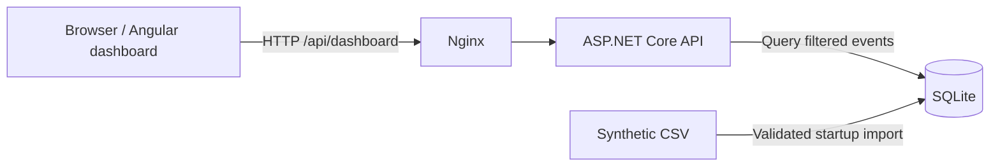

# Digicom Communication Dashboard

A web dashboard for exploring synthetic phone communication data, built for the [Digicom exercise](Digicom_Aufgabenstellung.pdf). It imports communication events from CSV, calculates contact-center KPIs, and presents five visualizations with a shared period filter.

This application is a functional proof of concept developed for a technical hiring assessment. It demonstrates the core requirements and selected architectural decisions, but is not intended to be production-ready.

## Implementation Overview

- **Implemented:** CSV import, the required contact counts and KPIs, department statistics, five visualizations, a shared period filter, basic automated tests, and Docker startup.
- **Architecture:** An Angular 22 frontend uses an ASP.NET Core API on .NET 10; EF Core and SQLite provide persistence, with CsvHelper for import and ECharts for visualization. Nginx serves the frontend and proxies API requests in Docker.
- **Optional features:** Runtime AI management summaries and AI quality assessments were left out, as agreed. Routing recommendations are also not implemented.
- **Scope:** The assessment focuses on core functionality and understandable, testable business logic. Production concerns—including comprehensive error handling, accessibility, scalability, durable persistence, and exhaustive test coverage—are not fully addressed. The limitations below distinguish the agreed scope exclusions from remaining technical gaps.

## Development Approach

AI-assisted coding tools and coding agents, including Codex, supported implementation, review, documentation, and validation activities. Written specifications and scoped tasks guided agent-assisted work, with generated changes and results reviewed by the developer and checked through focused tests and additional validation. Responsibility for architectural decisions, correctness, and the final implementation remains with the developer.

AI-assisted software development is separate from the AI-assisted creation of synthetic test data described below. Neither implies that runtime AI features are implemented.

## Start with Docker

Prerequisites: Docker, Docker Compose, and a running Docker daemon. No local .NET or Node.js installation is needed for this approach.

Run from the repository root:

```bash
docker compose up --build
```

Open **http://localhost:8080**. The API is available at **http://localhost:8080/api/dashboard**. If your installation provides the standalone `docker-compose` command, use it in place of `docker compose` throughout these instructions.

The frontend image contains the Angular production build served by Nginx. Nginx proxies `/api/` to the backend on Docker's internal network; the backend has no host port mapping. Its first startup applies database migrations and imports the bundled CSV into SQLite.

Stop and remove the containers:

```bash
docker compose down
```

### Database lifecycle

SQLite is stored at `/app/data/digicom.db` inside the backend container. No database volume or source-code bind mount is configured.

- Restarting the same container preserves the database and skips importing existing data.
- Removing the backend container discards the database.
- Rebuilding an image alone does not reset a database in an existing container.
- CSV changes are not applied to an already-populated database.

To start with freshly imported data:

```bash
docker compose down
docker compose up --build
```

This intentionally simple storage setup is suitable for the exercise; it does not provide durable production storage.

## Local development

Prerequisites: **.NET 10 SDK**, **Node.js 24**, and **pnpm 12.9.1**. These match the runtime families used by the Docker builds.

From the repository root, start the backend:

```bash
dotnet restore backend/DigicomApi.slnx
dotnet run --project backend/Digicom.Api --launch-profile http
```

In another terminal, start the frontend:

```bash
cd frontend/digicom-dashboard
pnpm install --frozen-lockfile
pnpm start
```

Open **http://localhost:4200**. The Angular development proxy forwards `/api` requests to **http://localhost:5125**. The development backend also exposes its OpenAPI document at **http://localhost:5125/openapi/v1.json**.

The local SQLite database is `backend/Digicom.Api/data/digicom.db`. To reset it, stop the backend, remove that database and any associated SQLite journal/WAL files, and start the backend again. This discards imported data and triggers a fresh import.

## Technologies and architecture

| Area | Technologies |
| --- | --- |
| Backend | C#, .NET 10, ASP.NET Core Minimal API |
| Persistence and import | Entity Framework Core 10, SQLite, CsvHelper |
| Frontend | Angular 22, TypeScript, signals, RxJS |
| Presentation | Tailwind CSS 4, Apache ECharts 6 through ngx-echarts, Day.js |
| Testing | TUnit and ASP.NET Core integration tests; Vitest with Angular TestBed |
| Deployment | Docker Compose, multi-stage Docker builds, Nginx |



In local development, Angular's development proxy takes the place of Nginx. The frontend uses relative API URLs in both environments.

The backend keeps endpoint handling, KPI calculations, and CSV import in separate classes. The calculation service operates on communication events without requiring a database, which makes the business logic directly testable. EF Core handles database access and migrations; no additional repository layer is needed for this small application.

Angular loads the dashboard lazily and uses signals and computed values for its state and chart options. Period changes request a new dashboard result from the API. The backend filters the records before calculating KPIs and department statistics; chart components aggregate the returned events for display.

| Location | Responsibility |
| --- | --- |
| `backend/Digicom.Api/Features/Dashboard/` | Dashboard endpoint, response DTOs, and KPI calculations |
| `backend/Digicom.Api/Infrastructure/` | EF Core model and CSV importer |
| `backend/Digicom.Api/Migrations/` | SQLite schema migrations |
| `backend/Digicom.Api/data/` | Application CSV and local database |
| `backend/Digicom.Tests/` | Calculation, import, and API tests |
| `frontend/digicom-dashboard/src/app/` | Dashboard, shared UI, chart components, and API service |
| `compose.yaml` | Frontend/backend container setup |

### Startup import

On startup, the backend applies migrations and checks whether communication events already exist. If the database is empty, CsvHelper parses the bundled CSV, validates its records, shifts timestamps for the demo, and inserts all records in a transaction. Validation occurs before insertion; an invalid or missing CSV prevents initial startup rather than leaving a partially imported dataset.

The application imports `backend/Digicom.Api/data/digicom_communications_v7.csv`. The root CSV is an identical copy for inspection. There is no upload endpoint or random-data seeder.

## Data model and assumptions

Each communication event has a database-generated `Id` and the following CSV fields:

| Field | Meaning and representation |
| --- | --- |
| `Timestamp` | Communication timestamp; treated as UTC |
| `Direction` | `inbound` or `outbound` |
| `Channel` | `phone` |
| `CustomerId` | Synthetic customer identifier |
| `Department` | Support, Sales, Accounting, or Orders |
| `Agent` | Positive numeric telephone extension |
| `CallerNumber` | Synthetic Austrian-format phone number; corresponds to “Anrufernummer” in the exercise |
| `DurationSeconds` | Conversation duration in seconds |
| `WaitingTimeSeconds` | Waiting time in seconds |
| `Status` | `answered`, `missed`, `abandoned`, or `failed` |
| `QualityScore` | Nullable integer from 1 to 5 |

Answered contacts have positive conversation duration; unanswered contacts have zero duration. Waiting times and durations are nonnegative, and outbound contacts have zero waiting time. Extensions belong to one department each.

**QualityScore is present only for answered inbound contacts.** Outbound and unanswered contacts are unrated. Empty scores mean missing observations, not a score of zero. This is a project assumption: the exercise lists scores from 1 to 5 without specifying how missing ratings should be handled. The current dataset contains a score for every answered inbound contact.

The importer checks required values, enum values, positive extensions, numeric ranges, and the duration/waiting rules. It rejects outbound quality scores, but does not enforce the absence of scores on unanswered inbound contacts; that rule was checked separately on the supplied dataset.

The exercise describes abandoned contacts as “Sprachbox.” This dataset models them as unanswered contacts with zero conversation duration; voicemail recording duration is not represented separately.

### Dates and timezones

CSV timestamps have no timezone suffix and are assumed to be UTC. On first import, one common offset moves the latest source date to the current UTC date. Time-of-day and relative spacing are preserved, but original weekdays are not: shifted contacts can fall on weekends or later on the current day.

Dates do not shift again on restart. As the demo ages, Today or other recent filters can return no data. Browser-local calendar days define the period filters, and charts display timestamps in browser-local time; displayed hours can therefore differ from the CSV clock times.

The application combines UTC timestamps with browser-local calendar boundaries. Daylight saving time (DST) edge cases, particularly transitions between standard time and summer time, were not explicitly addressed or tested. Correct handling of these cases is therefore not guaranteed; comprehensive DST handling was outside the intended scope of this proof of concept.

## KPIs

All calculations use the currently selected period. Counts include both directions unless stated otherwise.

| KPI | Calculation |
| --- | --- |
| Total contacts | Number of communication events |
| Inbound / outbound | Number of events in each direction |
| Answered / missed / abandoned / failed | Number of events with each status |
| Average duration | Mean DurationSeconds across answered contacts, both directions |
| Average waiting time | Mean WaitingTimeSeconds across all inbound contacts, all statuses |
| Average QualityScore | Mean non-null QualityScore across answered inbound contacts |
| Reachability | Answered inbound contacts ÷ all inbound contacts × 100 |
| Department distribution | Number of all contacts in each department |
| Department waiting time | Inbound waiting-time average restricted to each department |
| Department QualityScore | Answered inbound quality average restricted to each department |

Averages with no eligible observations and reachability with no inbound contacts are unavailable. The API omits null properties and the KPI cards display `–`; an empty period returns zero counts and empty event/department arrays. Null department averages are excluded from their bar charts.

## Visualizations and filtering

| Visualization | Purpose |
| --- | --- |
| Contacts over time | Stacked inbound/outbound bars reveal volume changes and traffic peaks |
| Waiting time by department | Horizontal bars compare inbound waiting times |
| QualityScore by department | Horizontal bars compare answered inbound quality ratings |
| Contacts by department | A donut chart shows each department's share of all contacts |
| Waiting time / quality heatmap | Shows rating distributions at different waiting times |

The heatmap selects inbound contacts with non-null scores. In the supplied dataset, these are exclusively answered inbound contacts. Waiting-time bands are `[0, 15)`, `[15, 30)`, `[30, 60)`, `[60, 90)`, `[90, 120)`, and `≥120` seconds. Each cell shows the percentage of rated contacts in that band with the corresponding score. Darker shading indicates a higher percentage; an empty band has no observations. The chart relies on the supplied dataset's rating rule because the event DTO does not expose Status.

The period filter offers All, Today, Yesterday, Last 7 days, and Last 30 days. The last two include today and the preceding 6 or 29 complete calendar days. All KPIs and charts update from the same API result. Contact aggregation is hourly for Today/Yesterday and daily for the other options, including empty time buckets within the displayed range. The full-period daily view does not directly show the aggregate midday concentration.

### API

```http
GET /api/dashboard
GET /api/dashboard?from=2026-10-01T00:00:00Z&to=2026-10-02T00:00:00Z
```

The first request returns all imported data. A bounded request must supply both timestamps, with `from < to`, and uses an inclusive start and exclusive end: `[from, to)`. Use UTC ISO timestamps with `Z`. The example bounds are fixed and may return no events because imported dates shift.

Successful requests return dashboard counts, nullable averages/rates, department statistics, and events ordered by timestamp. Each event contains timestamp, direction (`Inbound`/`Outbound`), waiting time, and an optional quality score. Customer identifiers, caller numbers, and agent extensions are not included in the dashboard response. Invalid date ranges return HTTP 400.

## Synthetic data and results

The CSV contains **793 synthetic phone events** across **20 weekdays**, originally **14 September–9 October 2026**. AI assistance was used to design and generate artificial events and deliberate patterns. Structural and business checks were then applied to the data. No real customer or communication records were intentionally used.

The exact original generator and complete prompts were not preserved. The checked-in CSV provides a fixed, repeatable input, but exact regeneration from a random seed is not available. Austrian country/mobile/geographic prefixes make the phone numbers realistic-looking; subscriber numbers are not verified as unassigned. Quality ratings are simulated and do not represent actual feedback.

### Dataset totals

| Metric | Full-dataset result |
| --- | ---: |
| Total events | 793 |
| Inbound / outbound | 651 / 142 |
| Answered / missed / abandoned / failed | 668 / 55 / 43 / 27 |
| Answered, rated inbound contacts | 544 |
| Average answered duration | 314.53 s |
| Average inbound waiting time | 89.13 s |
| Average answered inbound QualityScore | 3.30 / 5 |
| Reachability | 83.56% (544/651) |

| Department | Contacts | Extensions | Average inbound wait | Average answered inbound quality |
| --- | ---: | --- | ---: | ---: |
| Support | 430 | 20–29 | 129.05 s | 2.70 / 5 |
| Sales | 150 | 31–33 | 36.82 s | 4.13 / 5 |
| Accounting | 85 | 41–42 | 36.19 s | 3.91 / 5 |
| Orders | 128 | 51–53 | 47.09 s | 3.69 / 5 |

There are 18 distinct extensions. Daily volumes range from 24 to 167 events, averaging 39.65 events per represented weekday. Values above describe the complete dataset; a selected period will give different results.

### Deliberate anomalies

1. **Midday inbound concentration:** 257 of 651 inbound contacts (39.5%) occur from 11:00 inclusive to 13:00 exclusive in the CSV clock times. The hourly chart helps examine time-of-day demand.
2. **Elevated Support waiting times:** Support averages 129.05 seconds, compared with 36.19–47.09 seconds elsewhere. Its answered inbound quality average is also lower. The department charts expose this difference.
3. **Lower quality at longer waits:** Across 544 answered inbound contacts, the Pearson correlation between waiting time and quality is **−0.6264**. Contacts waiting 0–25 seconds average 4.26/5; those waiting over 90 seconds average 2.52/5. The heatmap shows this relationship, but does not display the correlation coefficient.

Daily traffic also spikes on the original 8 and 9 October dates, with 167 and 89 contacts respectively. These two days account for 32.3% of the dataset, compared with an average of 29.83 contacts on the preceding 18 represented weekdays.

These patterns are synthetic. Higher workload or insufficient staffing are possible interpretations, not proven explanations; correlation does not establish causation.

### Plausibility checks

The dataset review checked required columns and values, allowed categories, parseable timestamps, weekday coverage, extension ownership, the `+43` prefix, nonnegative durations/waits, status/duration consistency, outbound waiting times, and score eligibility/range. All 544 answered inbound contacts have scores and all other contacts have none. Counts, departmental averages, daily volumes, midday concentration, and correlation were recalculated from the CSV. The root and application copies were also confirmed identical.

The dataset exceeds the exercise's minimum 300 events and includes the three deliberate patterns. These checks establish consistency of the demo data; they do not prove that it is statistically representative. Holidays, staffing schedules, transfers, voicemail recordings, and complex routing behavior are not modeled separately.

## AI features and routing recommendations

AI-assisted data creation was used. Runtime **management summaries**, **AI communication-quality assessments**, and **routing recommendations** are not implemented. The displayed QualityScore is a synthetic input, not an AI assessment generated by the application. No dashboard data is sent to an external AI service, and no API key is required.

A future integration could receive structured, filtered KPI aggregates and measured anomalies, excluding customer identifiers, caller numbers, and event-level personal data. Numerical statements should be validated against those aggregates, with a clearly labeled deterministic fallback when the AI service is unavailable. Any quality assessment or routing recommendation would need an explanation based on measured values and human review before operational use. This is an extension proposal, not current behavior.

## Tests and build checks

Backend tests use TUnit with Microsoft Testing Platform. Run these commands **from `backend`**, where `global.json` selects the test runner:

```bash
cd backend
dotnet restore
dotnet test --no-restore
```

The 9 backend tests cover reachability, inbound waiting time, quality-score averaging, department statistics, CSV import and date shifting, repeat-import skipping, invalid-CSV rejection without insertion, API date-boundary filtering, and rejection of a missing date boundary. Import and API tests use SQLite in memory.

Frontend tests use Vitest and Angular TestBed:

```bash
cd frontend/digicom-dashboard
pnpm install --frozen-lockfile
pnpm test --watch=false
pnpm build
```

The 10 frontend tests cover basic app/component creation, complete calendar-day filter bounds, and heatmap percentages, unrated/outbound exclusion, empty bands, and recalculation after input changes. The production build checks Angular compilation and bundling.

Automated verification and additional review checks are separate:

- **Automated:** On 14 October 2026, the documentation refinement reran `dotnet test --no-restore` from `backend` and `pnpm test --watch=false` plus `pnpm build` from the frontend directory. All **9 backend tests** and **10 frontend tests** passed, and the Angular production build succeeded.
- **Dataset validation:** The refinement independently recalculated the dataset totals, averages, and anomaly figures and confirmed that the root and application CSV copies match.
- **Earlier runtime checks:** The earlier project review checked Docker startup, frontend/API serving, invalid and empty API filters, independent CSV calculations against all scalar KPIs, and restart without duplicate import. The Docker runtime review preceded the switch to the current CSV; the current dataset was subsequently exercised by the import tests. Docker was not rerun for this documentation refinement.

Browser rendering, responsive layouts, and a full AXE audit were not verified. Test coverage is intentionally limited; there is no claim of complete unit or end-to-end coverage.

## Known limitations and scope decisions

- **Desktop-first design:** The dashboard was primarily designed for desktop browsers. Comprehensive responsive optimization for smartphones and tablets was outside the technical assessment scope, and those layouts have not been fully verified. Smaller-screen use may still be possible; layout quality is not guaranteed.
- **Request failures:** Robust error handling is outside the agreed exercise scope. A failed period request can leave previous results visible while the dropdown shows the newly requested period; the status badge can still indicate an active dashboard. Errors are logged to the console.
- **Loading and empty states:** Dedicated loading indicators, retry controls, and an explicit no-results message were left out. Initial loading/failure can leave only the header visible.
- **Accessibility:** Accessibility was not a priority within the agreed exercise scope, but remains necessary for production use. The document language is declared as German to match the predominantly German UI. Known gaps include low contrast for small KPI units and charts without accessible data alternatives. WCAG AA/AXE compliance is not claimed.
- **Demo dates:** Timestamp shifting can place events on weekends or later today. Dates stay fixed after import, so recent filters can become empty. Calendar realism was outside scope.
- **Deployment:** Startup import assumes one backend instance. Concurrent initialization is not guarded against duplicate import. There is no durable database volume, authentication, or production hosting configuration.
- **Scale:** The API loads the selected events into memory and returns event-level chart data. This is reasonable for the supplied dataset; larger datasets would benefit from server-side chart aggregation and smaller responses.
- **Synthetic data:** Ratings, traffic patterns, and numbers are artificial and are not evidence for operational decisions. Rating eligibility is a dataset convention that the heatmap relies on.

## Possible next steps

Improve request/loading/empty states and accessible chart alternatives; add focused end-to-end checks; introduce durable storage and guarded initialization if deployment expands; preserve a deterministic data generator; strengthen rating validation; and, if desired, add the optional AI features using verified aggregates and transparent fallback behavior.

## Copyright and Usage

Copyright © 2026 Alexander Kopp.

This project was independently developed by Alexander Kopp as a technical assessment submission for Digicom and is provided for evaluation in the hiring process. No open-source license is granted for the original project code unless explicitly stated otherwise. Third-party components remain subject to their respective licenses.
